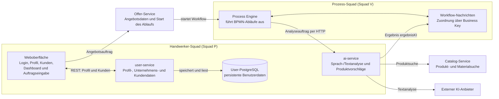

written by Laura Knaub

# Handwerker-Squad in der neuen Systemarchitektur

## Zweck und Leseschlüssel

Dieses Dokument erklärt, welche Teile der neuen Werkmundo-Architektur dem
Handwerker-Squad zugeordnet sind, wo sie im Repository liegen und wie sie mit
den anderen Komponenten zusammenarbeiten. Es richtet sich auch an Leserinnen
und Leser, die das Projekt oder die verwendeten Fachbegriffe noch nicht kennen.

Mit **Handwerker-Squad** ist hier Team 1 aus der
[Zuständigkeitsübersicht](team-ownership.md) gemeint. Die Bezeichnung
„Squad P“ aus der Architekturzeichnung beschreibt denselben Bereich.
Die Zeichnung ist eine vereinfachte Zuständigkeitsübersicht; das Diagramm
weiter unten zeigt den derzeit dokumentierten technischen Ablauf.

Die Dokumentation unterscheidet zwischen:

- **Umgesetzt / im Repository vorhanden:** Quellcode, Konfiguration oder
  Schnittstellen sind vorhanden.
- **Vorgesehen / noch nicht vollständig nachgewiesen:** Eine Komponente ist
  für den Ablauf vorgesehen, fehlt aber zum Beispiel im lokalen Setup oder
  wurde nicht als vollständiger End-to-End-Ablauf bestätigt.

## Einordnung in einem Satz

Das Handwerker-Squad stellt die Benutzeroberfläche und die Funktionen für
Handwerkerkonto, Kunden- und Unternehmensprofil sowie KI-gestützte
Auftragserfassung bereit. Die Oberfläche nutzt dafür den `user-service`;
KI-Aufträge laufen laut Service-Vertrag über den Angebotsservice und die
Process Engine zum `ai-service`. Das Squad betreibt weder den Prozessablauf
noch eine eigene Dashboard-Microservice-Implementierung.

## Architekturüberblick

Die Anmeldung wird zusätzlich mit **Keycloak** abgestimmt. Keycloak ist der
Dienst für Anmeldung und Identität; die fachlichen Profil- und Kundendaten
bleiben davon getrennt im `user-service` und seiner Datenbank.

Die Verbindungen über Offer-Service, Process Engine, Catalog-Service und
externen KI-Anbieter zeigen die vorgesehene beziehungsweise im Service-Vertrag
beschriebene Zusammenarbeit. Sie bedeuten nicht, dass alle diese Dienste im
lokalen Setup verfügbar oder als vollständiger Ablauf getestet sind.

## Was das Handwerker-Squad wo ergänzt

| Baustein | Ablage im Repository | Aufgabe und Abgrenzung |
|---|---|---|
| Benutzeroberfläche | `frontend/View/user`, `frontend/View/dashboard`, `frontend/View/voice`, `frontend/View/onboarding` | Zeigt Anmeldung, Dashboard, Auftragseingabe und Einrichtungsansichten. Die View ist die sichtbare Oberfläche im Browser. |
| Frontend-Logik | `frontend/ViewModel/user`, `frontend/ViewModel/dashboard`, `frontend/ViewModel/voice` | Verbindet Ansichten mit Anmelde-, Dashboard- und Eingabelogik. Das ViewModel hält UI-Abläufe von der Darstellung getrennt. |
| Frontend-Daten und API-Aufrufe | `frontend/Model/user`, `frontend/Model/dashboard`, `frontend/Model/voice`, `frontend/infrastructure/api` | Beschreibt Frontend-Daten und kapselt HTTP-Aufrufe, zum Beispiel an Benutzer- und KI-Schnittstellen. |
| Benutzer- und Kundenservice | `backend/services/user-service` | Stellt REST-Endpunkte für Registrierung, eigenes Profil, Unternehmensdaten, Profilwerte und Kunden bereit. |
| Benutzerdatenbank | Datenbank des `user-service` | Speichert fachliche Benutzer-, Unternehmens- und Kundendaten. Sie ist eine eigene Datenbank und wird nicht direkt vom Browser angesprochen. |
| KI-Service | `backend/services/ai-service` | Nimmt Analyseaufträge entgegen, strukturiert Beschreibungen in Angebotspositionen und kann passende Katalogprodukte suchen. Der Service besitzt keine eigene Datenbank. |
| KI- und Workflow-Verträge | `contracts/ai`, `contracts/workflow` | Beschreiben JSON-Datenformate, damit Services Aufträge und Ergebnisse in vereinbarter Form austauschen können. |
| Dashboard | `frontend/View/dashboard`, `frontend/ViewModel/dashboard`, `frontend/infrastructure/api/dashboardApi.ts` | Stellt Dashboard-Funktionen im Frontend bereit. Ein eigener ausführbarer `backend/services/dashboard-service` ist im aktuellen Repository nicht vorhanden. |

Die Zuordnung gibt den Stand der zentralen
[Team-Ownership-Dokumentation](team-ownership.md) wieder. Sie beschreibt
fachliche Verantwortungsbereiche und ist nicht gleichbedeutend mit einem
separaten Server oder einer eigenen Datenbank für jede Zeile.

## Die Komponenten in verständlicher Sprache

### 1. Browseroberfläche und Frontend

Das Frontend ist die Anwendung, die ein Handwerker im Browser bedient. Es
enthält Ansichten und zugehörige Logik für Benutzer, Dashboard und
Sprach-/Texteingabe. API-Adapter bündeln die Kommunikation mit dem Backend,
damit die Ansichten nicht selbst Serveradressen und technische Details
verwalten müssen.

Das Dashboard kann beispielsweise Kunden über die Benutzer-API laden. Ein
Dashboard-Bildschirm ist dabei zunächst nur ein Teil der Oberfläche und kein
eigener Backend-Service.

Im aktuellen Quellstand existieren sowohl eine Login-Ansicht als auch ein
Keycloak-fähiges Auth-ViewModel. Die Login-Ansicht enthält jedoch noch einen
direkten Navigationspfad zum Dashboard; sie ruft in diesem Pfad das
Auth-ViewModel nicht auf. Deshalb ist eine vollständige Anmeldung direkt über
den Browser nicht allein durch das Vorhandensein dieser Dateien nachgewiesen.

### 2. `user-service` und Benutzerdatenbank

Der `user-service` ist die Backend-Komponente für Benutzer-, Unternehmens-
und Kundendaten. Das Frontend sendet dafür HTTP-Anfragen an seine REST-API;
der Service prüft die Anfrage und liest oder speichert die Daten in seiner
eigenen PostgreSQL-Datenbank.

Beispiele für die angebotenen Aufgaben sind:

- Registrierung und Lesen beziehungsweise Aktualisieren des eigenen Profils
- Pflege von Unternehmensangaben und Profilwerten
- Anlegen, Auflisten, Ändern und Löschen von Kunden
- Verwaltung von Profilbildern und Anstoßen eines Passwort-Resets

Keycloak stellt die Identität und Anmeldung bereit. Es ersetzt nicht die
Benutzerdatenbank: Identitätsdaten und fachliche Werkmundo-Profildaten haben
unterschiedliche Aufgaben. Die Rollen und Token-Prüfung müssen in der
Keycloak- und Service-Konfiguration zusammenpassen.

### 3. `ai-service` und die KI-gestützte Auftragserfassung

Der `ai-service` wandelt eine Beschreibung eines Auftrags in strukturierte
Informationen um, zum Beispiel Leistungen, Material, Notizen und eine
geschätzte Arbeitsdauer. Für Materialien kann er zusätzlich passende Produkte
im Katalog suchen. Preise werden laut Servicebeschreibung nicht an die KI
übermittelt; der Angebotsservice kann sie anhand einer Produkt-ID ergänzen.

Der AI-Service ist zustandslos: Er speichert die Angebote nicht in einer
eigenen Datenbank. Bei der vorgesehenen asynchronen Verarbeitung meldet er
das Ergebnis als Workflow-Nachricht `ergebnisKI` an die Process Engine zurück.
Ein **Business Key** ist dabei eine Kennung, mit der die Nachricht dem
richtigen Angebotsvorgang zugeordnet wird.

Ohne konfigurierten KI-Zugang kann der Service lokal mit einem Stub-Ergebnis
arbeiten; für die Katalogsuche ist ein Mock-Modus vorgesehen. Das ermöglicht
lokale Entwicklung, ist aber keine echte KI- oder Katalogintegration.

### 4. Process Engine und weitere Squads

Die Process Engine und BPMN-Modelle gehören laut Zuständigkeitsübersicht zum
Prozess-Squad (Squad V), nicht zum Handwerker-Squad. BPMN ist eine
standardisierte Darstellungsform für Geschäftsabläufe. Die Engine führt
solche Abläufe aus und koordiniert, wann ein Service aufgerufen wird und
welche Nachricht als Nächstes verarbeitet wird.

Der `ai-service` stellt dafür den KI-Schritt und den Rückkanal zum Workflow
bereit. Der Angebotsservice und der Katalog liegen ebenfalls außerhalb der
Handwerker-Squad-Zuständigkeit. Diese Trennung verhindert, dass die
Benutzeroberfläche direkt in Datenbanken oder interne Prozessschritte
eingreifen muss.

## Typischer Ablauf und Datenwege

### Profil oder Kunden verwalten

1. Der Handwerker öffnet eine Profil- oder Kundenansicht im Frontend.
2. Der Frontend-API-Adapter sendet eine REST-Anfrage an den `user-service`.
3. Der Service verarbeitet die Anfrage und greift auf seine PostgreSQL-
   Datenbank zu.
4. Das Ergebnis kommt als HTTP-Antwort zurück und wird in der Oberfläche
   angezeigt.

Der Browser spricht dabei nicht direkt mit PostgreSQL.

### Auftrag mit KI-Unterstützung erstellen

1. Der Handwerker erfasst eine Beschreibung als Sprache oder Text.
2. Für den vorgesehenen Gesamtprozess wird der Auftrag über den
   Angebotsservice an die Process Engine übergeben.
3. Die Process Engine startet den BPMN-Ablauf und ruft den `ai-service` auf.
4. Der `ai-service` erzeugt strukturierte Angebotsinformationen und kann
   Produktkandidaten beim Katalog suchen.
5. Der `ai-service` sendet das Ergebnis als `ergebnisKI`-Nachricht mit der
   Vorgangskennung zurück.
6. Die Process Engine setzt den Ablauf fort; die weiteren Angebots- und
   Prozessschritte gehören zu den dafür zuständigen Komponenten und Squads.

Der tatsächliche KI-Aufruf ist damit nicht als direkte Browser-zu-KI-
Verbindung beschrieben. Im lokalen Setup fehlen Process Engine und
Catalog-Service; der vollständige Ablauf ist dort folglich nicht verfügbar.

## Umsetzungsstand und wichtige Grenzen

- **Vorhanden:** Frontend-Bereiche für Benutzer, Dashboard und Eingabe,
  Frontend-API-Adapter sowie die Services und Schnittstellen, die in der
  obigen Tabelle genannt sind.
- **Nicht als eigener Service vorhanden:** Für das Dashboard ist aktuell
  kein ausführbares `dashboard-service`-Projekt im Repository vorhanden.
  Dashboard-Funktionalität im Frontend ist nicht dasselbe wie ein
  Dashboard-Backend.
- **Lokal eingeschränkt:** Der gemeinsame lokale Start umfasst den
  `user-service` und optional den `ai-service`, jedoch keine Process Engine
  und keinen Catalog-Service. Ohne diese Abhängigkeiten ist der vollständige
  KI- und Angebotsprozess nicht nachgewiesen.
- **Integration nicht pauschal bestätigt:** Vorhandene Keycloak-Konfiguration,
  REST-Endpunkte und Service-Container belegen für sich allein noch keinen
  durchgängigen Browser-, Token- und Geschäftsprozess-Test.
- **KI-Ersatzbetrieb:** Stub-Antwort und Mock-Katalog eignen sich für
  Entwicklung und Tests, ersetzen aber keine produktive KI- beziehungsweise
  Kataloganbindung.

Für lokale Start- und Integrationsgrenzen siehe
[Gemeinsamer lokaler Start](../local-setup/INTEGRATED-SETUP.md), für die
Endpunkte und Konfiguration des Benutzerservices dessen
[Service-Dokumentation](../backend/services/user-service/README.md) und für
Analyseablauf und KI-Schnittstellen die
[Dokumentation des AI-Service](../backend/services/ai-service/README.md).

## Begriffe

| Begriff | Bedeutung |
|---|---|
| **REST / API** | Vereinbarte HTTP-Schnittstelle, über die Programme Daten anfragen oder ändern. |
| **Service** | Eigenständige Backend-Komponente mit einer klar abgegrenzten fachlichen Aufgabe. |
| **PostgreSQL** | Datenbanksystem, in dem ein Service seine Daten dauerhaft speichern kann. |
| **Keycloak / OIDC** | Dienst und Standard für Anmeldung und Weitergabe geprüfter Identitätsinformationen. |
| **BPMN / Process Engine** | Modell und Ausführungsumgebung für einen mehrstufigen Geschäftsablauf. |
| **Workflow-Nachricht** | Mitteilung an die Process Engine, dass ein asynchroner Arbeitsschritt ein Ergebnis geliefert hat. |
| **Stub / Mock** | Vereinfachter Ersatz für einen externen Dienst, damit lokal ohne diesen Dienst entwickelt oder getestet werden kann. |
