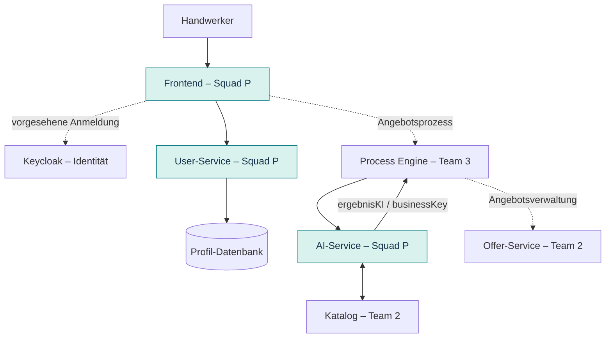

# Handwerker-Squad: Beitrag zur neuen Systemarchitektur

> **Stand:** 12.11.2026 · **Basis:** dokumentierter Repository-Stand auf `main`\
> **Für wen?** Alle Projektmitglieder – auch ohne Detailwissen über den Handwerker-Squad.

## Auf einen Blick

**Squad P (Team 1) verantwortet die Handwerker-Oberfläche, den User-Service und den AI-Service.** Die Bausteine decken Anmeldung/Profilverwaltung, Dashboard, Spracheingabe und die strukturierte Auswertung von Angebotsbeschreibungen ab. Ein vollständiger Angebotsprozess benötigt zusätzlich Komponenten anderer Teams.

| Beitrag von Squad P | Aufgabe | Code im Repository |
|---|---|---|
| **Frontend** | Login-/Registrierungsansichten, Profil, Dashboard, Spracheingabe | `frontend/View/user/`, `frontend/View/dashboard/`, `frontend/View/voice/` sowie jeweilige `ViewModel/`- und `Model/`-Bereiche |
| **User-Service** | Handwerker-, Unternehmens- und Kundenprofile verwalten | `backend/services/user-service` |
| **AI-Service** | Spracheingaben in Angebotsleistungen und Materialpositionen strukturieren | `backend/services/ai-service` |

## Wo sind die Komponenten in der Architektur?

**Leseschlüssel:** Grün markiert Komponenten von Squad P. Gepunktete Linien zeigen eine fachlich vorgesehene Verbindung – keine bestätigte vollständige Integration. Die Grafik ist eine vereinfachte Übersicht, kein Produktionsnachweis.

## Beispiel: Wie entsteht aus Sprache ein Angebot?

1. Der Handwerker erfasst eine Leistung per Sprache oder Text im Frontend.
2. Im vorgesehenen Angebotsablauf übergibt die **Process Engine** die Beschreibung an den **AI-Service**.
3. Der AI-Service ermittelt Leistungen, Materialien, Notizen und gegebenenfalls Korrekturvorschläge.
4. Für Materialien kann der **Katalog** nach Produkten durchsucht werden. **Preise** werden durch den zuständigen Angebots-Service ergänzt, nicht durch die KI.
5. Der AI-Service sendet das Ergebnis als Prozessnachricht an die Engine zurück. Andere Services übernehmen die weitere Angebotserstellung.

> Das beschreibt den vorgesehenen Ablauf. Eine durchgängige Ende-zu-Ende-Integration ist im dokumentierten Stand nicht nachgewiesen.

## Die drei Beiträge genauer erklärt

### 1. Frontend – was der Handwerker sieht

Die Oberfläche trennt **View** (Anzeige), **ViewModel** (Ansichtslogik) und **Model** (Datenmodell). Wichtig sind:

- `frontend/View/user/` – Login-, Registrierungs- und Profilansichten
- `frontend/View/dashboard/` – Dashboard
- `frontend/View/voice/` – Spracheingabe
- `frontend/infrastructure/api/userApi.ts` – API-Client für Nutzerfunktionen
- `frontend/infrastructure/auth/keycloakClient.ts` – vorgesehene Keycloak-Anbindung

### 2. User-Service – wer welche Profildaten verwaltet

Der Service verwaltet fachliche Handwerker- und Unternehmensdaten sowie Kundenprofile. **Keycloak** kümmert sich dagegen um Anmeldung und Identität. Laut Service-README verwendet der User-Service Java 17, Quarkus 3.15.1 und PostgreSQL. Die API beginnt mit `/api/users`.

| Beispiel-Endpunkt | Aufgabe |
|---|---|
| `POST /api/users/register` | Registrierung anstoßen |
| `GET /api/users/me` | Eigenes Profil lesen/synchronisieren |
| `PUT /api/users/profile` | Profil ändern |
| `PUT /api/users/company` | Firmendaten ändern (`OWNER`) |
| `/api/users/profile/hourly-rate` | Stundensatz konfigurieren |
| `/api/users/profile/travel-config...` | Anfahrt konfigurieren |
| `/api/users/customers` | Kundenprofile verwalten |

Die Rollen `OWNER` und `EMPLOYEE` begrenzen einzelne Funktionen.

### 3. AI-Service – wie Sprache zu strukturierten Daten wird

Der AI-Service ist **zustandslos und hat keine eigene Datenbank**.

| API | Verhalten |
|---|---|
| `POST /ai/analyze` | Synchron; Ergebnis kommt direkt zurück – geeignet für lokale Tests |
| `POST /ai/process` | Asynchron; zuerst HTTP 202, danach Prozessnachricht `ergebnisKI` mit `businessKey` an die Engine |

Lokal können ein **Stub** anstelle einer echten MegaLLM-Ausgabe und ein **Mock-Katalog** eingesetzt werden. Das testet den technischen Ablauf, nicht die reale KI- oder Kataloganbindung.

## Aktueller Integrationsstand: Was ist noch offen?

| Bereich | Was dokumentiert ist | Was das bedeutet |
|---|---|---|
| **Login** | `LoginView.tsx` navigiert beim Absenden derzeit direkt zum Dashboard; keine Anmeldung bei Keycloak oder User-Service aus dieser View. | Eine Login-Maske ist noch kein Nachweis für funktionierende Authentifizierung. |
| **API-Pfade** | Backend: `/api/users/...`; `userApi.ts`: derzeit `/customers`. | Frontend und Backend müssen abgestimmt und gemeinsam getestet werden. |
| **Angebotsprozess** | Vollständiger Prozess mit Engine ist durch den lokalen Containerstart nicht nachgewiesen. | Ende-zu-Ende-Test bleibt gesondert erforderlich. |
| **KI und Katalog** | Stub-Ausgaben und Mock-Katalog sind möglich. | Lokaler Test ist nicht gleich Live-Integration. |

**Wichtig:** Die Dokumentation beschreibt den Stand des Codes und seine Grenzen – keine Produktionsfreigabe.

## Lokal starten und prüfen

1. **Docker Desktop** starten.
2. Im Repository-Root `Start-Local.cmd` ausführen.
3. Nach der gemeinsamen Setup-Anleitung sind typischerweise erreichbar: Frontend `http://localhost:5173`, Keycloak `http://localhost:8090`, User-Service auf Port `8081`, Offer-Service auf `8082` und AI-Service optional auf `8086`.
4. AI-Service einzeln prüfen: `http://localhost:8086/q/health`; für synchrone Tests `POST /ai/analyze`.
5. Zum Beenden die Stop-Anleitung in `local-setup/INTEGRATED-SETUP.md` verwenden. Volumes nicht löschen, wenn lokale Daten erhalten bleiben sollen.

API-Schlüssel und lokal erzeugte Zugangsdaten **niemals committen**. `POST /ai/process` ist ohne laufende Process Engine kein vollständiger Ende-zu-Ende-Test.

## Abgrenzung zu anderen Teams

| Team | Zuständigkeit |
|---|---|
| **Squad P / Team 1** | Handwerker-Frontend, User-Service, AI-Service |
| **Team 2** | Offer-Service, Katalog |
| **Team 3** | BPMN, Process Engine, Connectoren, Nachrichtenkorrelation |

Änderungen an gemeinsamen Schnittstellen müssen mit den betroffenen Teams abgestimmt werden.

## Weiterführende Dokumentation

- [Team-Zuständigkeiten](team-ownership.md)
- [Integriertes lokales Setup](../local-setup/INTEGRATED-SETUP.md)
- [Installationsguide](InstallationsGuide.md)
- [User-Service-README](../backend/services/user-service/README.md)
- [AI-Service-README](../backend/services/ai-service/README.md)
- [AI-Service: offene Punkte](../backend/services/ai-service/docs/OFFENE-PUNKTE.md)
- [Squad-Integrationsprüfung](squad-integration-pruefung.md)

**Ablagehinweis:** Diese Datei gehört in den vorgesehenen Dokumentationsordner (`doc/` gemäß Akzeptanzkriterium; ggf. im Repository tatsächlich `documents/`). Relative Links bei abweichendem Ablageort prüfen.
